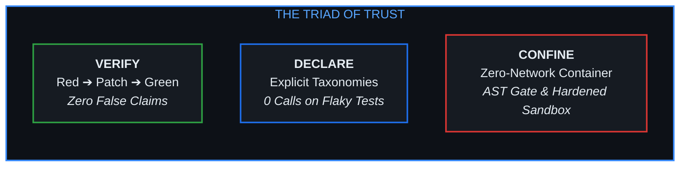
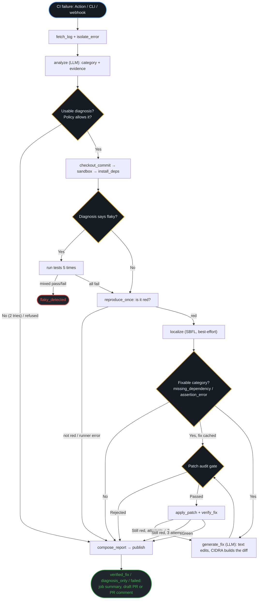
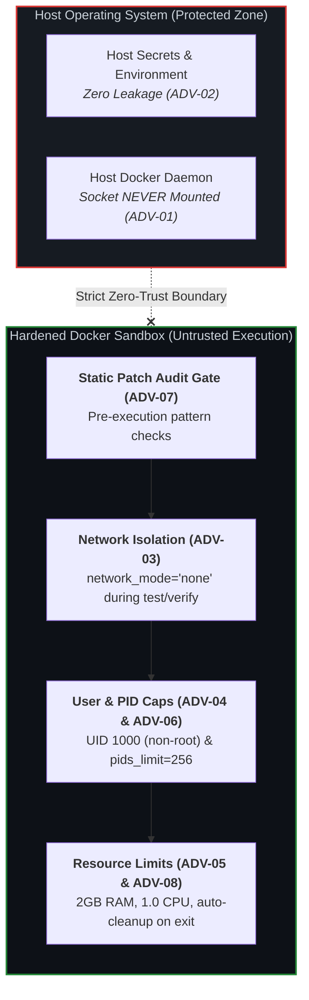

<div align="center">

<p align="center">
  
</p>

**Continuous Integration Debugging and Repair Agent**

*The autonomous, deterministic CI repair agent powered by LangGraph, Spectrum-Based Fault Localization (SBFL), and a hardened, zero-trust Docker execution sandbox.*

[](https://pypi.org/project/cidra/)
[](https://www.python.org/)
[](LICENSE)
[](#7-hardened-sandbox--threat-model-adv-01adv-08)
[](https://github.com/abhishekKokadwar/CIDRA/actions/workflows/test-cidra.yml)
[](#3-interactive-web-dashboard--hitl-gate)
[](https://cidra.vercel.app)

<p align="center">
  <a href="#1-core-philosophy--the-triad-of-trust">Philosophy</a> •
  <a href="#2-langgraph-architecture--workflow">Architecture</a> •
  <a href="#3-interactive-web-dashboard--hitl-gate">Dashboard</a> •
  <a href="#4-quick-start--installation">Quick Start</a> •
  <a href="#5-github-actions-integration">CI Integration</a> •
  <a href="#6-one-model-one-optional-fallback">LLM Fallback</a> •
  <a href="#7-hardened-sandbox--threat-model-adv-01adv-08">Threat Model</a> •
  <a href="#8-testing--verification-suite">Tests</a> •
  <a href="#9-repository-structure--development">Development</a>
</p>

<p align="center">
  
</p>

---

</div>

## 1. Core Philosophy & The Triad of Trust

Most "AI repair" tools blindly guess fixes, hallucinate green test outcomes, and dump untested diffs directly into pull requests.

**CIDRA is built on an adversarial foundation**: it assumes LLMs will hallucinate, dependencies may carry supply-chain attacks, and tests can be non-deterministic. Every action is gated by the **Triad of Trust**:



1. **Verify (Zero False Claims)**: CIDRA **never** claims a bug is fixed unless it reproduces the failure **red** inside an isolated Docker sandbox, applies the candidate patch, and re-executes the test suite to observe a clean **green** exit code. If a patch fails to apply or the tests remain red, the patch is discarded.
2. **Declare (Honest Failure Taxonomies)**: Rather than burning LLM tokens trying to fix environmental outages, flaky network calls, or invalid test configurations, CIDRA classifies root causes into formal categories. If an error is flaky, it declares `flaky_detected` and stops with **0 LLM fix attempts**.
3. **Confine (Zero-Trust Blast Radius)**: LLM generated code is treated as hostile by default. Patches pass through a static audit gate (blocking process execution, dynamic code evaluation, socket use, and edits that weaken or delete tests) before entering a network-disabled, non-root, PID-capped container.

---

## 2. LangGraph Architecture & Workflow

CIDRA orchestrates a 20-node cyclic state graph built on **LangGraph**. The workflow decouples log analysis from code generation and isolates untrusted operations into discrete state transitions.

### Runtime architecture

<p align="center">
  
</p>

The main way to run CIDRA is the GitHub Action (`cidra action`): a failed `workflow_run` starts it on the runner, with the failing commit checked out. `cidra fix` runs the same engine on a local checkout. The engine calls your own LLM provider (**BYOK**: any OpenAI-compatible endpoint via `CIDRA_API_KEY` + `CIDRA_BASE_URL`), gates every diff through the patch audit, and executes repo code only inside Docker containers (network on only for the dependency install). The webhook receiver (`cidra dashboard` / the FastAPI server) verifies the HMAC, claims an idempotency key, and fetches the failing commit from GitHub with the read-only token. The token is passed to that one fetch through its environment, so it is never written to disk or seen by the sandbox. A live webhook run has not yet been tested end to end ([KNOWN_GAPS G-02](docs/KNOWN_GAPS.md)). Full detail: [docs/4_architecture.md](docs/4_architecture.md).

### Repair workflow



### Key Engineering Innovations

- **Verified or nothing**: only two failure classes are patched, `missing_dependency` and `assertion_error` (an assert whose log prints both values). Everything else (`env_config_error`, `unknown`, flaky) ends as a diagnosis with no patch. A patch is reported as a fix only when the tests the CI log names failed in the sandbox before it, pass with it applied, and no test that passed before it now fails. Tests that were already failing for another reason may stay red; the report lists them.
- **Spectrum-Based Fault Localization (SBFL)**: In [cidra/nodes/sbfl.py](cidra/nodes/sbfl.py), CIDRA computes **Ochiai** and **Tarantula** suspiciousness scores from per-test coverage and adds the ranking to the fix prompt. It is best-effort: when no spectrum is collected the fix runs without it, and no live run has collected one yet ([KNOWN_GAPS G-01](docs/KNOWN_GAPS.md)).
- **Flakiness Detection (SR-08)**: when the diagnosis says `flaky_test`, CIDRA runs the tests 5 times in the sandbox. Mixed pass/fail ends the run as `flaky_detected` with no fix attempted; all-fail continues as an ordinary failure. A failure CIDRA would patch is reproduced twice, and a test that passes on the second run is treated the same way. Two runs catch an intermittent test often, not always.
- **Static Patch Audit Gate**: Every patch is checked before it reaches the sandbox ([cidra/nodes/audit.py](cidra/nodes/audit.py)). The gate matches patterns on the added lines and uses Python's `ast` to count assertions and to read the failing test's expected values. It rejects `os.system`/`os.popen`, `subprocess`, `socket`, `eval`/`exec`, dynamic imports, unsafe deserialization, any change that deletes, skips or weakens a test or touches CI config, any edit to a test file other than correcting an assert's expected value, a new module named after the missing dependency (a stand-in), and `if <test input>: return <expected value>` special cases. A rejected patch ends the run as `diagnosis_only`; it is not retried. It does not block a plain `import os`; the no-network, non-root sandbox is what contains code the gate does not catch.
- **Fix Cache**: a verified diff is stored in `cidra_fix_cache.json` under a fingerprint of the error. The same failure again skips the fix-generation call (the diagnosis call still runs), and the cached diff is still audited and re-verified in the sandbox. The cache is a local file: in GitHub Actions it is lost with the runner unless you persist it yourself.

---

## 3. Interactive Web Dashboard & HITL Gate

CIDRA includes a reactive web dashboard built with React, Vite, and custom CSS design tokens. It provides real-time visibility into the repair pipeline and a **Human-In-The-Loop (HITL)** approval gate.

- **🌐 Live Cloud Dashboard (Mobile & Desktop)**: [https://cidra.vercel.app](https://cidra.vercel.app) *(accessible anywhere without installation)*
- **💻 Local Dashboard (CLI)**:
```bash
# Launch the dashboard locally (automatically opens in your browser)
cidra dashboard
```

### Dashboard Capabilities

1. **Command Center**: Real-time KPI counters tracking mean time to recovery (MTTR), repair success rate, token consumption, and system health status.
2. **Run Explorer**: Complete trace inspector displaying step-by-step state transitions, raw CI terminal logs, and syntax-highlighted unified diffs.
3. **Visual Orchestrator**: A diagram of the LangGraph topology with an animated walkthrough. It is illustrative and does not follow a live run.
4. **4-Tab Configuration Manager**:
   - **API Keys**: Configure the primary model key, the Gemini fallback key and GitHub PAT credentials with **one-click live round-trip latency probes**.
   - **Model Chain**: Configure analysis models, fix models, and base URLs.
   - **Flakiness & Sandbox**: Flaky-run count, container timeout and retry limit. The fields can be edited and are saved to `.env`, but the engine does not read them: it uses the constants in `cidra/config.py` and `cidra/sandbox/limits.py` (5 runs, 3 fix attempts, 300 s per test run).
   - **Runtime Status**: View active paths, worktree directories, and SQLite database connectivity.
5. **HITL (Human-in-the-Loop) Review**: Inspect candidate diffs and the verification result, and record an approval. CIDRA never merges: merging the draft pull request is done by a person on GitHub.

---

## 4. Quick Start & Installation

### Option A: Standard PyPI Installation (Recommended)

CIDRA is distributed as a lightweight, pre-packaged Python wheel bundling the compiled web dashboard.

```bash
# Install CIDRA via pip
pip install cidra

# Bring your own key: any OpenAI-compatible endpoint
export CIDRA_API_KEY="..."
export CIDRA_BASE_URL="https://openrouter.ai/api/v1"
export CIDRA_MODEL_ANALYZE="<model id>"
export CIDRA_MODEL_FIX="<model id>"

# Launch the visual dashboard
cidra dashboard
```

### Option B: Local Repository Repair

To diagnose and repair a failing codebase locally without pushing to GitHub:

```bash
# Ensure local Docker daemon is running, then build the sandbox container.
# From a clone:
docker build -t cidra-sandbox:base -f cidra/sandbox/Dockerfile cidra/sandbox
# From a pip install (the Dockerfile ships inside the package from the next release;
# the 0.2.0 wheel on PyPI does not contain it, so build from a clone for now):
docker build -t cidra-sandbox:base "$(python -c 'import cidra, os; print(os.path.join(os.path.dirname(cidra.__file__), "sandbox"))')"

# That image runs Python 3.11. If the repository's workflow asks actions/setup-python
# for 3.7-3.10, 3.12 or 3.13 (or has a .python-version file), CIDRA builds a matching
# image the first time it is needed, which takes about a minute.

# Run CIDRA against your local repository
cidra fix
```

`cidra fix` repairs the last commit (`HEAD`), not uncommitted changes; it warns if there are any. Every step runs in Docker, including the first test run that produces the failure log, so the repository's code never runs on your machine. It never pushes or comments.

### Option C: Terminal User Interface (Rich TUI)

If you are working in a headless server environment without a browser:

```bash
python -m cidra.tui
```

---

## 5. GitHub Actions Integration

CIDRA runs natively inside your GitHub Actions workflows using the `workflow_run` trigger. This eliminates external SaaS dependencies and runs entirely within your runner's security boundaries.

### Dual-Token Security Architecture

To protect production branches from compromised dependencies or malicious PRs:
- **`CIDRA_GITHUB_TOKEN_RO`**: Read-only PAT used to fetch workflow run logs and commit metadata. Optional: when it is not set, the write token is used for reads too.
- **`CIDRA_GITHUB_TOKEN`**: Scoped write PAT used strictly to push verified fix branches and open Draft PRs.

### Complete Workflow (`.github/workflows/cidra.yml`)

```yaml
name: CIDRA Autonomous Repair

on:
  workflow_run:
    workflows: ["CI", "Test Suite"]
    types: [completed]

jobs:
  repair:
    name: Diagnose and Repair
    runs-on: ubuntu-latest
    if: ${{ github.event.workflow_run.conclusion == 'failure' }}
    permissions:
      contents: write
      pull-requests: write
      actions: read

    steps:
      - name: Checkout Codebase
        uses: actions/checkout@v4
        with:
          # The commit whose CI failed, not the default branch's tip
          ref: ${{ github.event.workflow_run.head_sha }}
          fetch-depth: 0
          # Do not leave the job's token in the checkout of untrusted code
          persist-credentials: false

      - name: Set up Python
        uses: actions/setup-python@v5
        with:
          python-version: '3.11'

      - name: Install CIDRA
        # From the repository until a release newer than 0.2.0 is on PyPI:
        # the 0.2.0 wheel does not contain the sandbox Dockerfile used below.
        run: pip install "git+https://github.com/abhishekKokadwar/CIDRA.git"

      - name: Build Sandbox Image
        # The Dockerfile ships inside the installed package
        run: docker build -t cidra-sandbox:base "$(python -c 'import cidra, os; print(os.path.join(os.path.dirname(cidra.__file__), "sandbox"))')"

      - name: Execute Autonomous Repair
        env:
          CIDRA_API_KEY: ${{ secrets.CIDRA_API_KEY }}
          CIDRA_GITHUB_TOKEN: ${{ secrets.CIDRA_GITHUB_TOKEN }}
          CIDRA_GITHUB_TOKEN_RO: ${{ secrets.CIDRA_GITHUB_TOKEN_RO }}
          CIDRA_ENABLE_PR_CREATION: "true"
          # How the sandbox installs and tests this repository (see "Install and test commands")
          # CIDRA_INSTALL_COMMAND: "pip install --quiet -r requirements-dev.txt"
          # CIDRA_TEST_COMMAND: "PYTHONPATH=src pytest -q 2>&1"
        run: cidra action

      - name: Trigger Live Dashboard Rebuild (Vercel)
        if: always()
        run: |
          if [ -n "${{ secrets.VERCEL_DEPLOY_HOOK }}" ]; then
            curl -s -X POST "${{ secrets.VERCEL_DEPLOY_HOOK }}"
          fi
```

### Install and test commands

The sandbox installs dependencies with `pip install --quiet -r requirements.txt` and runs `pytest -q`. If your repository does it differently, set both. With the composite action they are the `install_command` and `test_command` inputs; with `cidra action` they are `CIDRA_INSTALL_COMMAND` and `CIDRA_TEST_COMMAND`.

- **Install** runs with network, in a throwaway container, and must be a single `pip install` of the dependencies: CIDRA appends `--target` to it. The project itself is not installed; tests import it from the source tree. Examples: `pip install --quiet -r requirements-dev.txt`, `pip install --quiet pytest httpx`.
- **Test** runs with no network. Put `2>&1` at the end so the log CIDRA reads includes errors. For a `src/` layout: `PYTHONPATH=src pytest -q 2>&1`.

### Repository setup for pull requests

- **Never run the failing commit's code on the runner.** A `workflow_run` job has the repository's secrets, even when the failure came from a fork's pull request. CIDRA only copies that code into the sandbox, which has no secrets and no network outside the install step. Do not add steps that install or test it on the runner.
- **Allow Actions to open pull requests.** In the repository: Settings → Actions → General → "Allow GitHub Actions to create and approve pull requests". Without it GitHub returns 403: the fix branch is pushed but no PR is opened.
- **Who opens the pull request.** With the built-in `GITHUB_TOKEN` (the default, no setup) the fix PR is opened by `github-actions[bot]` and the fix commit is authored by `CIDRA`. This is the recommended setup: no personal credential is involved.
- **CI on CIDRA's pull requests.** GitHub does not start workflows for a PR opened with the built-in `GITHUB_TOKEN`, so the fix PR shows no checks until a person pushes to it or re-opens it. The fix has already been verified in the sandbox. To get checks automatically, pass a GitHub App installation token as `github_token`; the PR is then opened by that app's bot. A personal access token also works, but the PR then appears to come from that person, so it is not recommended.
- **Where the PR goes.** A fix for a failure on a branch push is opened as a draft PR against that branch. A fix for a failure on an existing pull request is pushed to that PR's branch, and is never force-pushed.
- **Every run leaves a job summary** on the Actions run page with the diagnosis, whatever the outcome. The job fails when the outcome is `failed`: no log, no usable diagnosis, no sandbox, dependencies that did not install, or a failure that did not reproduce in the sandbox. In the last two cases the summary currently says "could not produce a usable diagnosis" even though a diagnosis was made; check the install and test commands first.
- **Without a pull request** (a failure on a branch push with PR creation off, or a run that ends without a fix) the job summary is the only output: CIDRA does not comment on the commit.

---

## 6. One Model, One Optional Fallback

CIDRA is bring-your-own-key: one key, one OpenAI-compatible endpoint, the models you choose. Each call is tried up to 3 times (a 65-second back-off on a rate limit). If it still fails and `GEMINI_API_KEY` is set, the same call is tried once more on Gemini (`CIDRA_FALLBACK_MODEL`, default `gemini-3.5-flash`), unless the primary endpoint already is Gemini. Without that key there is no fallback. Fallback calls count against the same per-run caps (`CIDRA_MAX_LLM_CALLS`, `CIDRA_MAX_LLM_TOKENS`).

### Configuration Environment Variables (`.env`)

Copy [.env.example](.env.example) to `.env` to configure your environment:

| Variable | Description | Default |
|---|---|---|
| `CIDRA_API_KEY` | Key for the primary endpoint | *Required* |
| `CIDRA_BASE_URL` | Primary OpenAI-compatible endpoint | `https://generativelanguage.googleapis.com/v1beta/openai/` |
| `CIDRA_MODEL_ANALYZE` | Model ID for root cause analysis | `gemini-3.5-flash` |
| `CIDRA_MODEL_FIX` | Model ID for patch generation | `gemini-3.5-flash` |
| `GEMINI_API_KEY` | Key for the one fallback, Gemini, used when the primary call fails | *Optional* |
| `CIDRA_FALLBACK_MODEL` | Gemini model for the fallback | `gemini-3.5-flash` |
| `CIDRA_GITHUB_TOKEN` | GitHub token with branch and PR write permissions | *Optional (for PRs)* |
| `CIDRA_GITHUB_TOKEN_RO` | Read-only GitHub token for CI logs | *Optional (falls back to the write token)* |
| `CIDRA_ENABLE_PR_CREATION` | Open a draft PR for a verified fix | `false` |
| `CIDRA_MAX_LLM_CALLS` | Most model requests one run may make (retries and fallbacks included) | `8` |
| `CIDRA_MAX_LLM_TOKENS` | Most tokens one run may spend | `40000` |
| `CIDRA_INSTALL_COMMAND` | One `pip install` of the dependencies, run in the sandbox (`--target` is appended) | `pip install --quiet -r requirements.txt` |
| `CIDRA_TEST_COMMAND` | Test command, run in the sandbox with no network | `pytest -q 2>&1` |
| `CIDRA_WEBHOOK_SECRET` | HMAC SHA256 secret for webhook validation | *Optional (for webhook)* |
| `CIDRA_DASHBOARD_TOKEN` | Token for the dashboard API; required to serve it on a non-loopback host | *Optional* |
| `CIDRA_AUDIT_SIGNING_KEY` | Key that signs the audit manifest; without it the manifest is unsigned | *Optional* |

The flaky-run count (5), the fix-attempt limit (3) and the sandbox timeouts (300 s per test run) are constants in [cidra/config.py](cidra/config.py) and [cidra/sandbox/limits.py](cidra/sandbox/limits.py), not environment settings.

---

## 7. Hardened Sandbox & Threat Model (ADV-01..ADV-08)

The Docker sandbox ([cidra/sandbox/runner.py](cidra/sandbox/runner.py)) is CIDRA's highest blast-radius component. Its isolation boundaries are hardcoded into the runner architecture and cannot be overridden by callers.



Checked by the Docker isolation tests in [tests/integration/test_sandbox.py](tests/integration/test_sandbox.py) and [tests/unit/test_audit.py](tests/unit/test_audit.py).

---

## 8. Testing & Verification Suite

CIDRA maintains high test coverage with automated unit and integration verification suites:

```bash
# 1. Run the server and API tests (47 tests)
pytest tests/server -v

# 2. Run the core unit tests (184 tests: SBFL, patch audit, git ops, LangGraph routing)
#    No Docker, network or API key needed
pytest tests/unit -v

# 3. Run the Docker integration tests against a clone of the practice repo (23 tests)
CIDRA_PRACTICE_REPO=/path/to/cidra-practice pytest tests/integration -v

# 4. Run the Dashboard-to-Backend live wiring test suite
cd dashboard
npm run test:wiring
```

### Test Suite Summary

- **Server Test Suite (`tests/server/`)**: 47 tests (FastAPI endpoints, HMAC signatures, settings persistence, replay safety).
- **Core Unit Suite (`tests/unit/`)**: 184 tests (Ochiai/Tarantula SBFL ranking, patch audit guards, git isolation, flaky detection).
- **Integration Suite (`tests/integration/`)**: 23 tests (real sandbox runs on fixture branches and corpus repositories; skipped when `CIDRA_PRACTICE_REPO` is not set).
- **Key-free end-to-end run**: `scripts/fake_llm.py` stands in for the model so the whole pipeline can run without an API key.
- **Wiring Verification (`test-backend-wiring.js`)**: 5 checks (live latency probes to the primary endpoint and Gemini, settings round-trip, telemetry parsing).

### Measured results

From [eval/measure.py](eval/measure.py): real model, real sandbox, publishing in dry run. One small paid model for both runs (named in the result files), priced at $1 / $5 per million input / output tokens.

| | 7 practice fixtures ([result](eval/results/claude-haiku-4-5.json)) | 18 real bugs from BugsInPy ([result](eval/results/claude-haiku-4-5-bugsinpy-v3.json)) |
|---|---|---|
| Correct diagnosis | 7 / 7 | 12 / 18 |
| Verified fix, where one exists | 4 / 4 | 1 / 12 |
| Correctly declined | 3 / 3 | 6 / 6 |
| "Verified" fix that fails held-out tests | 0 / 4 | not judged (youtube-dl-3 has no validated held-out set) |
| Median cost per run | $0.008 | $0.011 |
| Total cost | $0.05 | $0.28 |

The practice fixtures are small failures built for this project. The BugsInPy cases are real bugs in fastapi, httpie, thefuck, tornado and youtube-dl, chosen by rules fixed before any model ran ([eval/corpus/README.md](eval/corpus/README.md)). On those, CIDRA declined every case it should and claimed no false fix, and fixed 1 of the 12 fixable ones (youtube-dl-3: a one-line regex change in the same place as the project's own fix, but not identical to it).

Every fix attempt is recorded in the result file. Of the 27 attempts, 7 reached the test run and did not turn it green (6 still failing, 1 broke another test), 2 were refused for editing a test's setup, 1 did not apply, and 13 returned no edits: the model said it could not see the cause, either because the code to change was not shown to it or because pytest cut the assertion diff short. The run before the last two fixes ([v2](eval/results/claude-haiku-4-5-bugsinpy-v2.json)) fixed 0 of 12, and none of its 19 patches reached the test run: 15 did not apply. Diagnosis varies between runs of the same model (14/18 in v2, 12/18 here); the analysis step did not change. What to fix next is in [ROADMAP M3](docs/ROADMAP.md).

---

## 9. Repository Structure & Development

The repository is organized cleanly into source, dashboard, documentation, and tests:

```text
cidra/
├── .github/workflows/    # CI and PyPI publishing automation
├── cidra/                # Python Core Engine
│   ├── integrations/     # LLM multi-tier clients & GitHub REST API
│   ├── nodes/            # Graph node functions (20 nodes are wired in graph.py)
│   ├── sandbox/          # Hardened Docker sandbox (runner.py, limits.py)
│   ├── server/           # FastAPI backend & settings API
│   ├── static/           # Production web dashboard bundle (embedded in wheel)
│   ├── cli.py            # CLI entry points (dashboard, fix, action)
│   ├── config.py         # Central configuration and .env loading
│   ├── graph.py          # LangGraph state machine definition
│   └── state.py          # Pydantic schemas
├── dashboard/            # Modern React + Vite frontend source code
│   ├── src/              # UI components, views, icons, design system tokens
│   ├── vite.config.js    # Direct-to-cidra/static compiler & dev server
│   └── package.json      # Frontend dependencies & wiring test scripts
├── docs/                 # Engineering specs, threat model, API contracts
├── eval/                 # Evaluation harness & benchmark fixtures
├── tests/                # Test suites
│   ├── unit/             # Unit tests (SBFL, patch audit, routing)
│   ├── integration/      # Docker sandbox tests (need the practice repo)
│   └── server/           # API tests (FastAPI, settings, webhook)
├── .env.example          # Template configuration
├── .gitignore            # Clean, standardized ignore rules
├── action.yml            # GitHub Action definition
├── pyproject.toml        # Package & wheel build configuration
└── README.md             # Project documentation
```

### Local Development Setup

```bash
# Clone the repository
git clone https://github.com/abhishekKokadwar/CIDRA.git
cd CIDRA

# Install Python package in editable mode with development dependencies
pip install -e ".[dev]"

# Install dashboard frontend dependencies
cd dashboard
npm install

# Start Vite dev server for frontend development
npm run dev

# Compile dashboard directly into cidra/static/
npm run build
```

---

<div align="center">

*Autonomous repair you can actually trust.*

</div>
